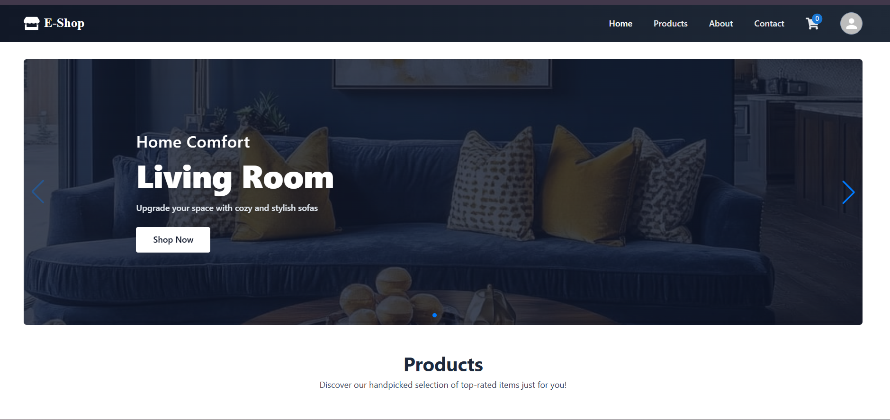
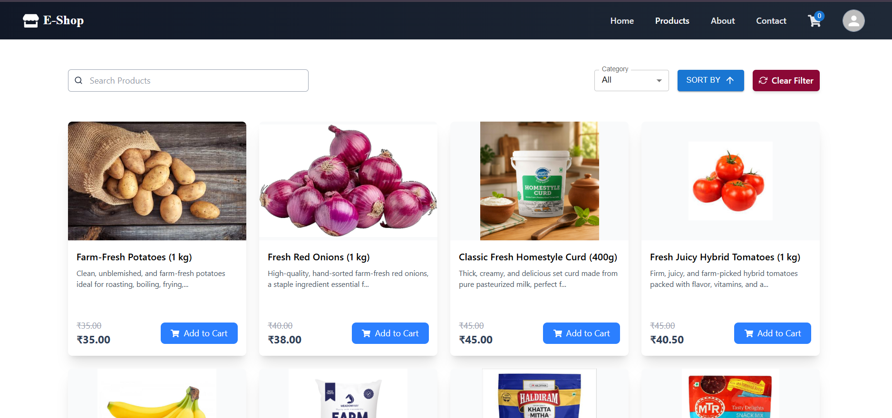
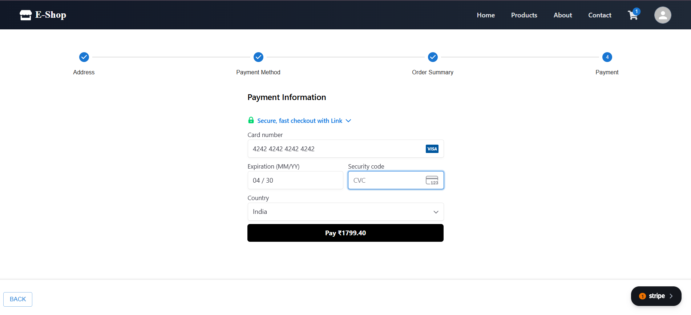
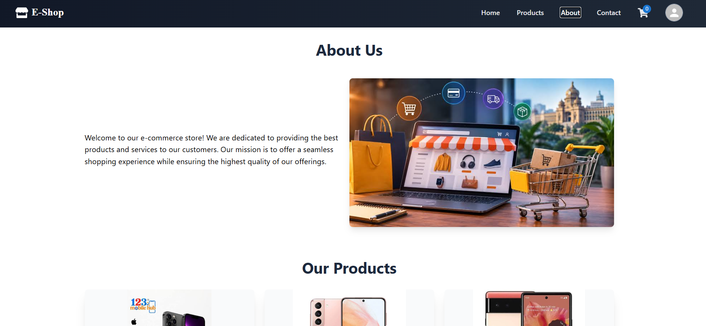
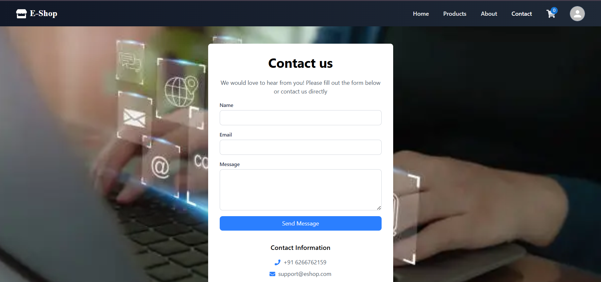
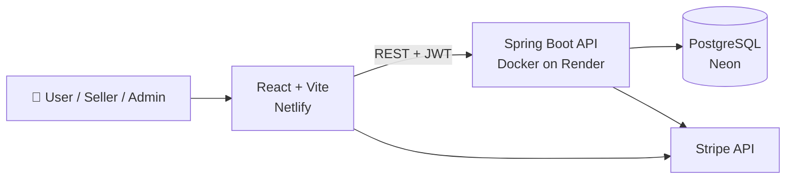

<div align="center">

# 🛒 E-Shop

### Full-Stack E-Commerce Platform with Role-Based Access (User · Seller · Admin)


**[🔗 Live Demo](https://dreamy-kleicha-011c14.netlify.app/)**

</div>

---

## 📖 Overview

E-Shop is a production-deployed e-commerce application. Customers can browse and filter products, manage a cart and pay through a secure multi-step Stripe checkout. **Sellers** list and manage their own products, and **Admins** manage categories, sellers, orders and view analytics.

**Highlights**
- 🔐 JWT authentication with Spring Security and three roles (User, Seller, Admin)
- 💳 4-step checkout (address → payment method → order summary → Stripe payment)
- 🏪 Seller marketplace with image upload
- 📊 Admin dashboard with products, orders and revenue analytics
- ☁️ Fully deployed: React on Netlify, Dockerised Spring Boot on Render, PostgreSQL on Neon

---

## 🧭 Table of Contents
[Screenshots](#-screenshots) · [Demo Accounts](#-demo-accounts) · [Features](#-features) · [Architecture](#-architecture) · [Tech Stack](#-tech-stack) · [Project Structure](#-project-structure) · [Getting Started](#-getting-started) · [Deployment](#-deployment) · [Roadmap](#-roadmap) · [Author](#-author)

---

## 📸 Screenshots

| Home | Products & Filters |
|------|--------------------|
|  |  |

| Cart | Stripe Payment |
|------|----------------|
|  |  |

| Admin Dashboard | Seller – Add Product |
|-----------------|----------------------|
|  |  |

<details>
<summary><b>View more screenshots</b></summary>

| Login | View Product |
|-------|--------------|
|  |  |

| Checkout – Address | Checkout – Payment Method |
|--------------------|---------------------------|
|  |  |

| Order Summary | Payment Success |
|---------------|-----------------|
|  |  |

| Admin – Products | Admin – Categories |
|------------------|--------------------|
|  |  |

| Seller Panel Access | About Page |
|---------------------|------------|
|  |  |

| About Page |
|------------|
|  |

</details>

---

## 🔑 Demo Accounts

Try every role on the [live demo](https://dreamy-kleicha-011c14.netlify.app/). These are test accounts only.

| Role | Username | Password |
|------|----------|----------|
| User | `<your-test-user>` | `<test-password>` |
| Seller | `<your-test-seller>` | `<test-password>` |
| Admin | `<your-test-admin>` | `<test-password>` |

> 💡 The backend runs on a free tier, so the first request after inactivity may take a few seconds to wake up.

**Test payment (Stripe test mode):** card `4242 4242 4242 4242`, any future expiry, any 3-digit CVC.

---

## ✨ Features

### 🛍️ Customer
- Auto-sliding hero banner, product cards with original and discounted prices (₹)
- Search, nested category filters, sort, clear filters and pagination
- Product view popup with large image, price, **In Stock** badge and description
- Cart with live item badge, quantity controls, remove item and subtotal
- Saved addresses (add, edit, delete) and order history
- Loading skeletons, spinners, error page, About and Contact pages

### 🔐 Authentication & Authorization
- Sign up and login with **JWT**, role-based access (User, Seller, Admin)
- Protected frontend routes (`PrivateRoute`) and secured backend endpoints
- Profile menu shows Orders, Seller Panel or Admin Panel based on role

### 💳 Checkout & Payments
1. **Address:** select, add, edit or delete
2. **Payment method:** Stripe (PayPal option in UI)
3. **Order summary:** billing address, items, tax and subtotal
4. **Payment:** secure Stripe card payment with a success confirmation page

### 🏪 Seller Panel
- Add products through the **Add Product** form with image upload
- View and manage orders for their products
- Role-restricted: no access to admin-only sections

### 🧑‍💼 Admin Panel
- **Dashboard:** total products, orders and revenue
- **Orders:** view, filter and update order status
- **Products:** view, add and upload images
- **Categories:** add, edit and delete categories and subcategories
- **Sellers:** add, view and filter sellers

### 🔧 Backend
- RESTful APIs for auth, products, categories, cart, addresses, orders and analytics
- Spring Security with JWT filter chain (`AuthTokenFilter`, `JwtUtils`, `AuthEntryPointJwt`)
- Stripe payment service and image upload service
- Global exception handling, DTO-based payloads, Swagger / OpenAPI docs

---

## 🏗️ Architecture



The Spring Boot backend follows a layered design: **Controller → Service → Repository → Database**, with DTOs separating API contracts from entities.

---

## 🧰 Tech Stack

| Layer | Technology |
|-------|-----------|
| Frontend | React, Vite, JavaScript, CSS |
| State management | Redux (actions and reducers) |
| Backend | Java, Spring Boot, Spring Security, Spring Data JPA |
| Authentication | JWT (JSON Web Tokens) |
| Database | PostgreSQL (Neon) |
| Payments | Stripe |
| API docs | Swagger / OpenAPI |
| Build tool | Maven |
| DevOps | Docker, Render (backend), Netlify (frontend), Neon (database) |

---

## 📁 Project Structure

<details>
<summary><b>Frontend – <code>ecom-frontend</code></b></summary>

```
ecom-frontend/
├── public/
├── src/
│   ├── api/                  # API configuration
│   ├── assets/sliders/       # Hero banner images
│   ├── components/
│   │   ├── admin/            # categories, dashboard, orders, products, sellers
│   │   ├── auth/             # Login, Register
│   │   ├── cart/             # Cart, CartEmpty, ItemContent, SetQuantity
│   │   ├── checkout/         # Address, payment method, summary, Stripe, PayPal
│   │   ├── home/             # Home, HeroBanner
│   │   ├── products/         # Products, Filter
│   │   └── shared/           # Navbar, Sidebar, ProductCard, Modal, Loader, ...
│   ├── hooks/                # useProductFilter, useCategoryFilter, useOrderFilter
│   ├── store/                # Redux actions and reducers
│   ├── utils/                # formatPrice, truncateText, constants
│   ├── App.jsx
│   └── main.jsx
├── index.html
└── package.json
```

</details>

<details>
<summary><b>Backend – <code>SpringBoot-ecom</code></b></summary>

```
SpringBoot-ecom/
├── src/main/java/com/ecommerce/project/
│   ├── config/               # App, Swagger and WebMvc configuration
│   ├── controller/           # Address, Analytics, Auth, Cart, Category, Order, Product
│   ├── exceptions/           # Custom exceptions and global handler
│   ├── model/                # JPA entities (User, Role, Product, Order, ...)
│   ├── payload/              # DTOs and response classes
│   ├── repositories/         # Spring Data JPA repositories
│   ├── security/             # JWT filters, request/response, WebSecurityConfig
│   ├── service/              # Business logic (incl. Stripe and file upload)
│   ├── util/
│   └── SpringBootEcomApplication.java
├── src/main/resources/application.properties
├── Dockerfile
└── pom.xml
```

</details>

---

## 🚀 Getting Started

### Prerequisites
- Node.js 18+ and npm
- Java JDK 17
- Maven (or the included `mvnw` wrapper)
- PostgreSQL (local, or a free [Neon](https://neon.tech) project)
- A Stripe account (test keys)

### 1. Clone

```bash
git clone https://github.com/<your-username>/<your-repo-name>.git
cd <your-repo-name>
```

### 2. Backend

Create `SpringBoot-ecom/.env`:

```env
DB_URL=jdbc:postgresql://<host>/<database>?sslmode=require
DB_USERNAME=your_db_username
DB_PASSWORD=your_db_password
JWT_SECRET=your_jwt_secret
STRIPE_SECRET_KEY=your_stripe_secret_key
FRONTEND_URL=http://localhost:5173
```

```bash
cd SpringBoot-ecom
./mvnw spring-boot:run
```

API: `http://localhost:8080` · Swagger UI: `http://localhost:8080/swagger-ui/index.html`

### 3. Frontend

Create `ecom-frontend/.env`:

```env
VITE_BACK_END_URL=http://localhost:8080
VITE_STRIPE_PUBLISHABLE_KEY=your_stripe_publishable_key
```

```bash
cd ecom-frontend
npm install
npm run dev
```

App: `http://localhost:5173`

### Run the backend with Docker

```bash
cd SpringBoot-ecom
docker build -t ecom-backend .
docker run -p 8080:8080 --env-file .env ecom-backend
```

---

## ☁️ Deployment

| Part | Platform | Notes |
|------|----------|-------|
| Database | **Neon** | Serverless PostgreSQL (SSL required) |
| Backend | **Render** | Web Service using the Docker runtime and the project `Dockerfile` |
| Frontend | **Netlify** | Build `npm run build`, publish `dist` |

1. **Neon:** create a project and copy the connection details into the backend environment variables.
2. **Render:** create a Web Service from the repo, choose **Docker**, and add the environment variables (database, JWT secret, Stripe key, frontend URL).
3. **Netlify:** import the frontend, set `VITE_BACK_END_URL` to the Render URL, and add a `public/_redirects` file with `/*  /index.html  200` so React Router routes work on refresh.

---

## 🧠 Challenges & Learnings
- Designing stateless **JWT authentication** and role-based authorization across Spring Security and protected React routes
- Integrating the **Stripe** payment flow into a multi-step checkout
- **Containerising** the backend with Docker and deploying it across Render, Neon and Netlify with environment-based configuration
- Structuring a layered Spring Boot API with DTOs, global exception handling and Swagger documentation

---

## 🔮 Future Roadmap -

**AI features**
- 🤖 AI shopping assistant chatbot
- 🔎 Smart search: natural-language, typo-tolerant ("cheap running shoes for kids")
- ✍️ AI-generated product descriptions for sellers
- 🎯 Personalised product recommendations

**Product features**
- Order tracking and email notifications
- Product reviews and ratings
- Wishlist
- Analytics charts on the admin dashboard
- Full PayPal payment flow

---

## 🤝 Contributing

Fork the repo, create a feature branch, commit your changes and open a Pull Request.

## 📄 License

Licensed under the [MIT License](LICENSE).

## 👤 Author

**Your Name**
[GitHub](https://github.com/your-username) · [LinkedIn](https://linkedin.com/in/your-profile) · your.email@example.com

⭐ If you found this project useful, please give it a star!
